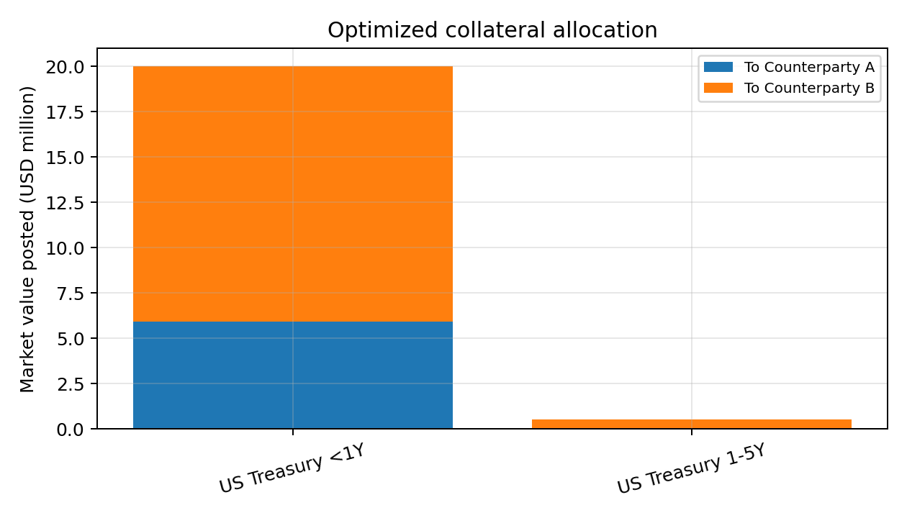

# Margin and Collateral Optimization Engine

SIMM-style initial margin for two counterparty netting sets, plus a linear program that chooses the cheapest eligible collateral to post. Python and Excel, with step-by-step documentation for readers with no background.

## Headline result (pinned market snapshot)

| | Value |
|:--|--:|
| Total SIMM-style initial margin | $20,405,490 (A $5,894,237, B $14,511,253) |
| Cash-only annual opportunity cost | $918,247 |
| Optimized annual opportunity cost | $31,290 |
| Saving | $886,957 (96.6%) |
| Shadow price of extra margin | 0.2551% per dollar (25 bps on a 2% haircut asset) |



## What is in here

| Path | Content |
|:--|:--|
| `python/margin_engine/` | `config.py` (all inputs), `simm_style.py` (IM), `collateral.py`, `optimizer.py` (LP), `analytics.py` (scenarios) |
| `python/run_all.py` | Runs everything, writes `outputs/`, asserts the headline numbers |
| `python/tests/` | 12 tests (formula checks, constraints, optimality against random allocations, shadow price, the zero-cash-cost bug) |
| `excel/Margin_Collateral_Optimization.xlsx` | Live formulas for IM and coverage checks; LP solution pasted from Python; scenario tables |
| `docs/Project_Documentation.docx` | Full explanation from first principles |
| `outputs/` | CSVs and figures |
| `legacy/` | The first single-script version, kept for history |

## Run

```
pip install -r python/requirements.txt
python python/run_all.py
python -m pytest python/tests
python python/build_excel.py
```

## Method in four lines

1. Exposures for each netting set (equity delta, FX delta, a duration-style rate exposure) times a risk weight per class (24%, 15.5%, 1.9%).
2. Aggregate with a 30% cross-risk-class correlation: `sqrt(sum WS^2 + 2 rho sum WS_i WS_j)`.
3. Collateral inventory with BCBS-IOSCO-style haircuts and an opportunity cost per asset (cash is the most expensive at 450 bps).
4. `scipy.optimize.linprog` (HiGHS) minimizes opportunity cost subject to post-haircut coverage of each IM, eligibility and inventory limits.

## Scenarios

Funding-rate sweep, haircut stress, initial-margin scaling with shadow prices, Treasury scarcity and eligibility cases. See `docs/Project_Documentation.docx` and `outputs/`.

## Honest limitations

- **SIMM-style means simplified.** Not ISDA SIMM, not ISDA certified; risk weights and correlations are illustrative.
- The rate leg is a duration-style notional equivalent, not a true PV01. A PV01-based cross-check in the same code gives a total IM of about $6.9 million, roughly a third of the headline, so the headline is conservative and illustrative.
- Delta risk only, one bucket per class, static one-period optimization, assumed opportunity costs, constructed portfolios.
- Prices are a pinned snapshot rounded to cents.

## A bug worth knowing about

An earlier version set cash's opportunity cost to zero. The optimizer then filled the whole cash line first and reported a meaningless saving. The fix is to charge cash the funding rate; `test_zero_cash_cost_bug_is_detectable` guards against it.

Author: Deepak Chaudhary
