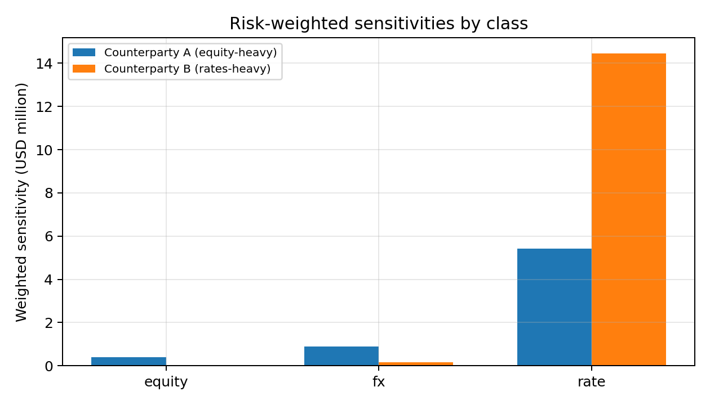
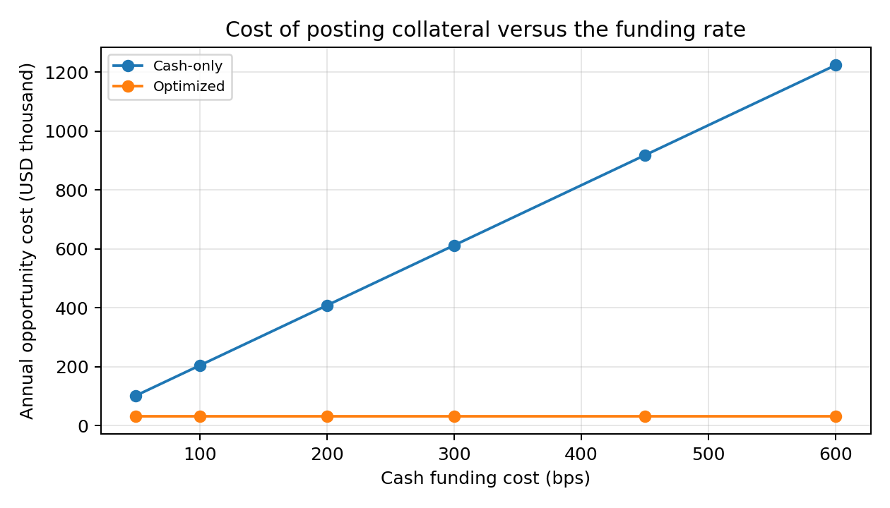
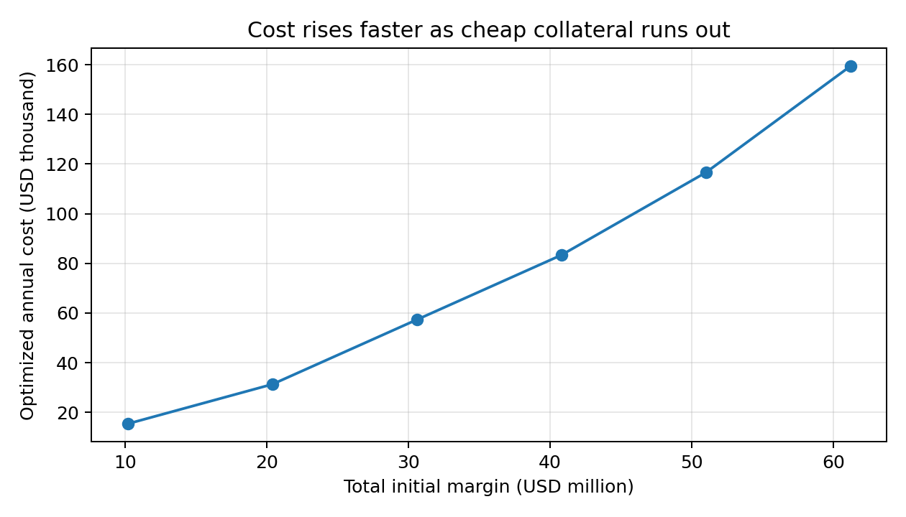

# 1. What this project does, in plain words

When two financial firms trade derivatives with each other (for example an interest rate swap), each worries the other might fail to pay. To protect against that, regulation requires each side to hand the other a safety deposit called **initial margin (IM)**. The deposit is not cash only: it can be made of **collateral**, meaning assets such as cash, government bonds, corporate bonds or shares, each with a safety discount called a **haircut**.

Two questions follow, and this project answers both with code:

1. **How big is the deposit?** The project computes a simplified, **SIMM-style** initial margin for two counterparties.
2. **What is the cheapest way to pay it?** Posting cash is expensive because the firm gives up the interest it could earn on that cash. Posting a government bond the firm already owns is much cheaper. A **linear program** chooses the least costly mix of assets that still covers each deposit after haircuts.

**Headline result (pinned market snapshot).** Total IM is about \$20.41 million. Posting it all in cash costs about \$918,247 a year in lost funding income. The optimized mix costs about \$31,290 a year, a saving of \$886,957 (96.6%).

**Honest labelling.** *SIMM-style* means a simplified illustration of the ISDA SIMM idea (risk weights, then aggregation with a correlation). It is **not** the ISDA SIMM model, is not ISDA certified, and its parameters are illustrative.

# 2. Background, from scratch

## 2.1 Derivative, counterparty and netting set

A **derivative** is a contract whose value depends on something else, such as a share price, an exchange rate or an interest rate. The firm on the other side of the contract is the **counterparty**. All trades with one counterparty under one legal agreement can be **netted**, meaning gains on some trades offset losses on others, and only the net amount matters. That bundle is a **netting set**.

## 2.2 Why margin exists

If the counterparty defaults, the survivor may lose money while replacing the trades. **Margin** reduces that loss. There are two kinds:

- **Variation margin (VM):** daily payments that follow the current profit or loss of the trades.
- **Initial margin (IM):** an extra buffer sized to cover the loss that could happen between the default and the close-out of the trades, with a high degree of confidence.

This project is about IM.

## 2.3 What ISDA SIMM is

The **ISDA Standard Initial Margin Model (SIMM)** is an industry-agreed formula that both sides can compute and agree on. In outline:

1. Measure **sensitivities**: how much the trades' value changes if a risk factor (a share price, FX rate, interest rate) moves a little.
2. Multiply each sensitivity by a **risk weight** that reflects how much that factor tends to move.
3. Combine the weighted numbers with **correlations**, so that risks that do not move together partly offset.

The result is a single dollar number for each counterparty.

## 2.4 Collateral, haircuts and opportunity cost

- **Eligible collateral** is the list of assets a counterparty will accept.
- A **haircut** is a discount applied to the market value. A bond worth \$100 with a 4% haircut counts as only \$96 towards the margin requirement. Riskier or longer-dated assets get larger haircuts. The haircuts here follow the BCBS-IOSCO standard schedule by asset type.
- **Opportunity cost** is what the firm gives up by posting an asset instead of using it elsewhere. For cash, that is the funding rate it could otherwise earn (about 450 basis points a year here; 1 basis point is 0.01%). For a government bond the firm holds anyway, the incremental cost is small (for example 15 to 35 basis points).

## 2.5 Linear programming

A **linear program (LP)** finds the best values of some decision variables to minimise a cost, when both the cost and the rules (constraints) are straight-line (linear) expressions. Here the decision variables are: how much market value of each asset to post to each counterparty. The cost is opportunity cost. The rules are: cover each counterparty's IM after haircuts, respect eligibility, and do not post more of an asset than the firm owns.

# 3. Inputs

All inputs sit in one config block (`python/margin_engine/config.py`) and are mirrored in the Excel `Inputs` sheet.

| Input | Value |
|:--|--:|
| AAPL, JPM, XOM share prices | \$341.07, \$343.06, \$160.59 |
| EURUSD | 1.1401 |
| US 10-year yield | 5.18% |
| Risk weights: equity, FX, rate | 24%, 15.5%, 1.9% |
| Cross-risk-class correlation | 30% |
| Cash opportunity cost | 450 bps a year |

The prices are a pinned snapshot rounded to cents. The original run used live, unrounded prices, which moves the total IM by about \$8 (0.00004%).

**Two counterparties.**

| | Counterparty A (equity-heavy) | Counterparty B (rates-heavy) |
|:--|--:|--:|
| Shares | 3,000 AAPL, 2,000 JPM | 500 XOM |
| EUR notional | 5,000,000 | 1,000,000 |
| USD rate notional | 30,000,000 | 80,000,000 |

**Collateral inventory.**

| Asset | Market value | Haircut | Opportunity cost (bps) | Eligible for A | Eligible for B |
|:--|--:|--:|--:|:-:|:-:|
| Cash (USD) | 15,000,000 | 0.0% | 450 | Yes | Yes |
| US Treasury under 1Y | 20,000,000 | 0.5% | 15 | Yes | Yes |
| US Treasury 1-5Y | 25,000,000 | 2.0% | 25 | Yes | Yes |
| US Treasury 5-10Y | 15,000,000 | 4.0% | 35 | Yes | Yes |
| IG corporate bonds | 10,000,000 | 8.0% | 55 | Yes | No |
| Large-cap equities | 8,000,000 | 15.0% | 80 | No | No |

# 4. Step 1: the initial margin calculation

## 4.1 Exposures

- **Equity delta** is the dollar value of the shares held: A has $3{,}000\times341.07 + 2{,}000\times343.06 = \$1{,}709{,}330$.
- **FX delta** is the euro notional converted to dollars: A has $5{,}000{,}000\times1.1401 = \$5{,}700{,}500$.
- **Rate exposure** is a duration-style notional equivalent: $\text{notional}\times\dfrac{10}{1+y}$, so A has $30{,}000{,}000\times 10/1.0518 = \$285{,}225{,}328$. This is a simplified scale (the notional multiplied by a duration of about 9.5), **not** a true dollar-per-basis-point sensitivity. Section 9 shows what a true PV01-based version gives.

## 4.2 Weighted sensitivities

Multiply each exposure by its risk weight. For Counterparty A:

| Class | Exposure | Risk weight | Weighted |
|:--|--:|--:|--:|
| Equity | 1,709,330 | 24% | 410,239 |
| FX | 5,700,500 | 15.5% | 883,578 |
| Rate | 285,225,328 | 1.9% | 5,419,281 |

## 4.3 Aggregate with a correlation

$$IM = \sqrt{\sum_i WS_i^2 + 2\rho\sum_{i<j} WS_i\,WS_j},\qquad \rho = 0.30.$$

Why this shape: if the three risks were perfectly independent ($\rho=0$), the total would be the square root of the sum of squares. If they were perfectly aligned ($\rho=1$), the total would be the simple sum. A correlation of 30% sits in between.

For A: $\sqrt{410{,}239^2+883{,}578^2+5{,}419{,}281^2 + 2(0.3)(\dots)} = \$5{,}894{,}237$.

## 4.4 Results

| | IM |
|:--|--:|
| Counterparty A | \$5,894,237 |
| Counterparty B | \$14,511,253 |
| **Total** | **\$20,405,490** |

Counterparty B's weighted rate sensitivity is \$14,451,417 (\$760.6 million exposure times 1.9%), which drives its IM.

{width=100%}

# 5. Step 2: the cheapest collateral, by linear program

## 5.1 The formulation

Decision variables: $a_i$ and $b_i$ are the market value of asset $i$ posted to Counterparty A and B.

$$\min \sum_i c_i\,(a_i+b_i)\quad\text{subject to}$$

$$\sum_i (1-h_i)\,a_i \ge IM_A,\qquad \sum_i (1-h_i)\,b_i \ge IM_B,$$

$$a_i + b_i \le MV_i,\qquad a_i=0\text{ if not eligible for A},\quad b_i=0\text{ if not eligible for B},\quad a_i,b_i\ge0.$$

where $c_i$ is the opportunity cost, $h_i$ the haircut and $MV_i$ the inventory. The solver is `scipy.optimize.linprog` with the HiGHS method.

## 5.2 The solution

| Asset | To A | To B | Total posted | Annual cost |
|:--|--:|--:|--:|--:|
| US Treasury under 1Y | 5,923,857 | 14,076,143 | 20,000,000 | \$30,000 |
| US Treasury 1-5Y | 0 | 515,806 | 515,806 | \$1,290 |
| Everything else | 0 | 0 | 0 | \$0 |

**Total annual cost: \$31,290.** The solver uses all of the cheapest asset (the under-1Y Treasuries), then a small amount of the next cheapest (1-5Y Treasuries). It does not use cash at all.

{width=100%}

## 5.3 The naive comparison

Posting the full requirement in cash (0% haircut) costs $20{,}405{,}490\times0.045 = \$918{,}247$ a year. The optimizer saves $918{,}247-31{,}290 = \$886{,}957$, which is 96.6%.

## 5.4 What the solver also tells you: the shadow price

Every constraint in an LP has a **shadow price**: the extra cost of tightening it by one unit. Here, the shadow price of Counterparty A's IM constraint is **0.2551% per dollar**. That equals $25\text{ bps}/(1-0.02)$, the cost per dollar of coverage of the 1-5Y Treasury, which is the **marginal asset** (the last one the solver uses). So: *if A's margin rises by \$1 million, the extra annual cost is about \$2,551*, until that asset also runs out. This is a useful number for pricing the cost of extra margin to a trading desk.

# 6. Scenarios

{width=100%}

**Funding rate sweep.** The optimized cost stays at \$31,290 because the optimizer never uses cash. The cash-only cost scales with the funding rate, so the saving rises from \$70,738 (50 bps) to \$1,193,040 (600 bps).

**Haircut stress.** Multiplying every haircut by 1.0, 1.5, 2.0, 3.0 raises the optimized cost only slightly (\$31,290 to \$31,876) because the cheap Treasuries have small haircuts to begin with, so the firm posts about 0.5% to 1.7% more market value than the IM.

**Initial margin scaling.** As total IM grows, cost grows faster than proportionally once the cheapest assets run out. The shadow price steps up from 0.255% to 0.365% at 2.5 times the base IM, and 0.598% at 3 times.

{width=100%}

**Treasury scarcity.** If only 25% of the Treasury inventory is available, cost rises to \$70,359. At 10% the firm is forced to use \$8.6 million of cash and cost jumps to \$438,144, showing how valuable a deep stock of high-quality liquid assets is.

**Eligibility.** If the under-1Y Treasuries are not accepted by Counterparty B, cost rises from \$31,290 to \$45,904. If neither counterparty accepts them, cost is \$52,055. Eligibility terms in the legal agreements therefore have a direct price.

# 7. The mistake that was caught and fixed

The first version of the model set cash's opportunity cost to **zero**. That is backwards: cash is the most expensive collateral because it forgoes the funding rate. With a zero cost, the optimizer fills the **whole \$15 million cash line first**, then covers the rest with Treasuries, and reports a total cost of only \$8,149, a fake saving. The fix was to set cash's opportunity cost to the funding rate (about 450 bps). A regression test (`test_zero_cash_cost_bug_is_detectable`) keeps this error from returning.

**Lesson.** An optimizer is only as good as its cost inputs. A result that looks too good deserves a sanity check against economic logic.

# 8. How the result was checked

The tests (`python/tests/test_engine.py`, 12 tests, all passing) check:

- The aggregation formula against hand calculations at $\rho=0$ and $\rho=1$.
- The IM lies between the root-sum-of-squares and the simple sum.
- Headline IM and costs match the pinned values.
- The allocation covers each IM after haircuts, respects inventory and eligibility.
- No random feasible allocation is cheaper than the LP solution (several thousand random trials).
- The shadow price equals the marginal asset's unit cost.
- Higher haircuts never reduce cost.
- An impossible request (20 times the IM) is correctly reported as infeasible.
- The cash-cost error is detectable.

The **Excel workbook** recomputes the IM and the coverage and cost checks with live formulas and matches Python to the cent.

# 9. Cross-check with a structured version

To test how much the simplified rate treatment matters, `structured_im` recomputes IM with:

- per-name equity buckets and a 15% within-bucket correlation;
- a true **PV01** for rates (dollars per basis point, $=\text{notional}\times\text{duration}/(1+y)\times 0.0001$) times a 60 bp risk weight, an illustrative figure.

It gives IM of about \$2.28 million (A) and \$4.63 million (B), a total of **\$6.9 million, about one third of the headline \$20.4 million**. The headline's rate leg multiplies a notional-equivalent scale by a percentage weight, which is much larger than a PV01-based weighting. This is why the headline should be described as **illustrative and conservative**, not as a prediction of what a real SIMM calculation would produce for these trades. The collateral-optimization logic is unaffected: it takes any IM figure as input.

# 10. Limitations

- Delta risk only. No vega, curvature, base correlation, credit or commodity classes.
- Single risk bucket per class in the headline method; real SIMM has many buckets and tenor correlations.
- Risk weights and correlations are illustrative, not ISDA calibrated.
- Static one-period optimization with no margin call timing, thresholds, minimum transfer amounts, concentration limits or collateral substitution costs.
- Opportunity costs are assumed, not derived from a repo curve.
- The portfolios and inventory are constructed examples, not a real book.

# 11. How to run

```
pip install -r python/requirements.txt
python python/run_all.py          # computes everything, writes outputs/, checks the headline numbers
python -m pytest python/tests     # 12 tests
python python/build_excel.py      # rebuilds the Excel workbook
```

# 12. Glossary

**Basis point (bp).** One hundredth of one percent.

**BCBS-IOSCO.** The Basel Committee and the securities regulators' group that set the global rules for margin on non-cleared derivatives.

**Collateral.** Assets pledged to secure an obligation.

**Counterparty.** The firm on the other side of a contract.

**Delta.** Change in a position's value for a small move in a risk factor.

**Haircut.** A discount applied to the market value of collateral.

**Initial margin (IM).** A buffer posted at the start of trading to cover potential loss after a default.

**ISDA.** International Swaps and Derivatives Association.

**Linear program.** An optimization with a linear cost and linear constraints.

**Netting set.** All trades with one counterparty that can be netted against each other.

**Opportunity cost.** What is given up by using an asset one way instead of another.

**PV01.** The change in value for a one basis point move in interest rates.

**Risk weight.** A factor that scales a sensitivity by how much the risk typically moves.

**Shadow price.** The change in the optimum cost per unit tightening of a constraint.

**SIMM.** The ISDA Standard Initial Margin Model.

**Variation margin (VM).** Daily payments that track the current profit or loss.
